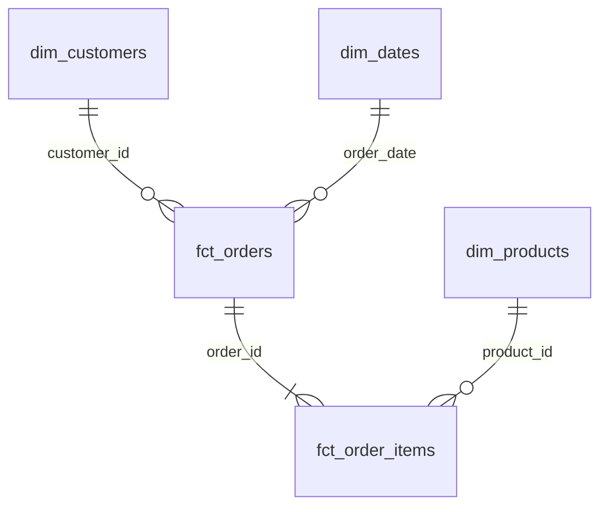
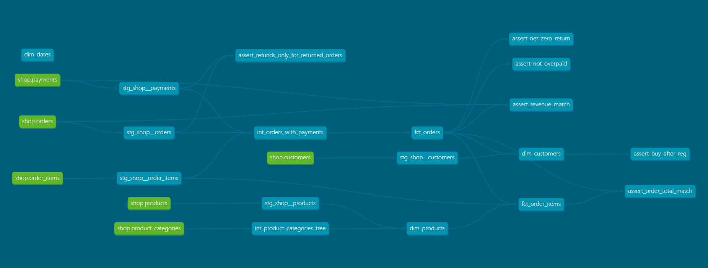

# store_hse - аналитические витрины интернет-магазина

## Модель данных

Проект реализует трёхслойную архитектуру данных (staging, intermediate, marts) на базе Greenplum с использованием dbt.

### ER-диаграмма

### Описание витрин

| Витрина | Тип | Зернистость | На какой бизнес-вопрос отвечает |
| --- | --- | --- | --- |
| fct_orders | Факт | Одна строка - один заказ | Сколько заказов оформлено? Какая доля подтверждённых заказов? |
| fct_order_items | Фак | Одна строка - один товар в заказе | Какие товары приносят больше всего выручки? Товары из какой категории продаются чаще всего?|
| dim_customers | Измерение | Одна строка - один клиент | Какие клиенты самые ценные? Какая доля клиентов, ни разу не совершивших покупку? |
| dim_products | Измерение | Одна строка - один товар | Как товары распределены по категориям? Какие бренды представлены больше всего? |
| dim_dates | Измерение | Одна строка - один день | Как меняются продажи по дням недели? Есть ли сезонность? |

### Хранение в Greenplum

Все витрины слоя в marts у нас в формате колоночной таблицы - это нужно для ускорения запросов, потому что есть возможность считывать только нужные колонки.

Ключи распределения выбраны с учётом частых соединений между таблицами:

| Витрина | Ключ распределения | Обоснование |
|---|---|---|
| fct_orders | order_id | order_id это ключ соединения с fct_order_items, такой выбор позволяет делать JOIN без пересылки данных между сегментами |
| fct_order_items | order_id | Совпадает с fct_orders |
| dim_dates | date_id | Первичный ключ |
| dim_customers | customer_id | Первичный ключ + соединение с fct_orders идёт через customer_id и для ускорения выгодно сделать распределение по нему |
| dim_products | product_id | Первичный ключ + соединение с fct_order_items идёт через product_id и для ускорения выгодно сделать распределение по нему |

Если бы fct_order_items и fct_orders были бы распределены по разным ключам, то при их соединении Greenplum выполнял бы пересылку данных между сегментами, что сильно замедлило бы запросы на больших объёмах данных.

### Lineage - граф зависимостей
